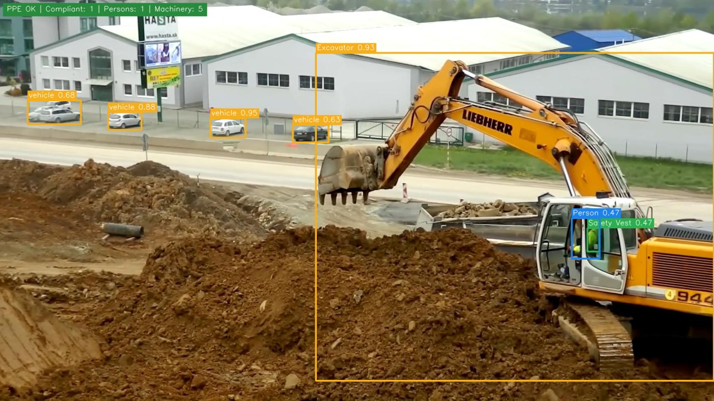
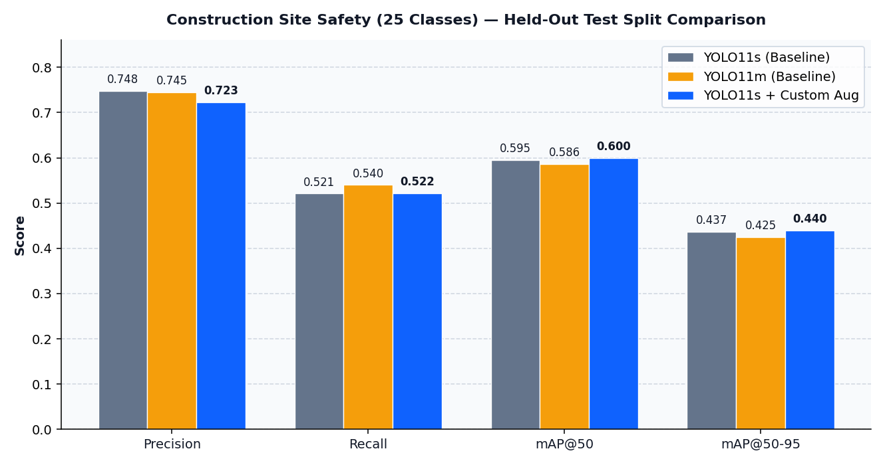
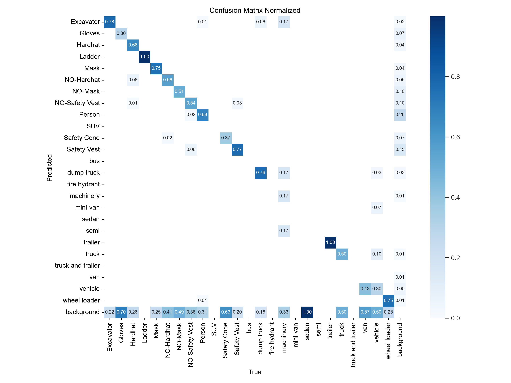
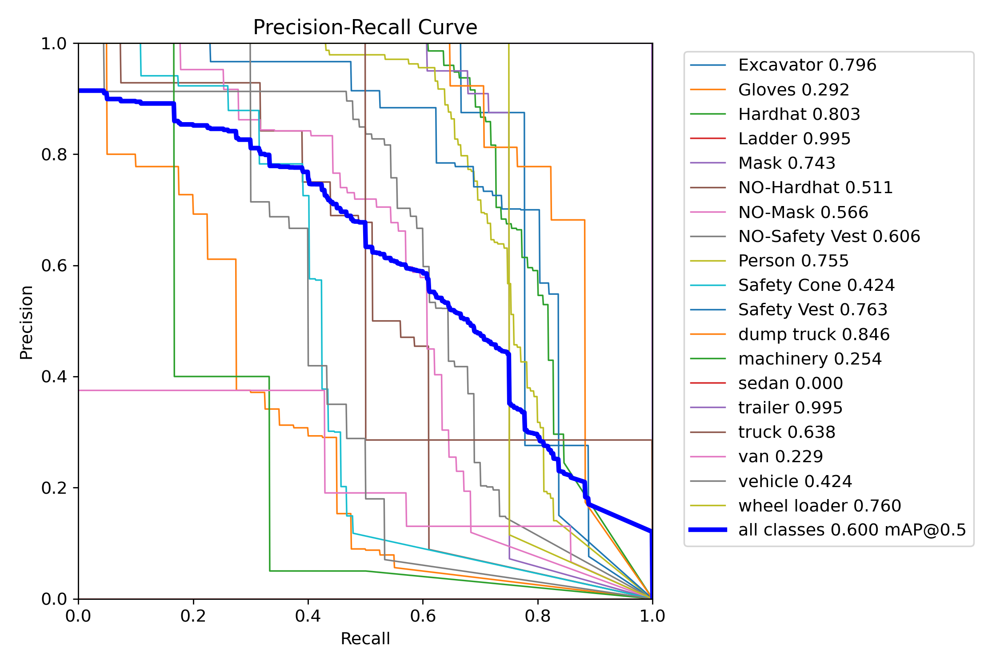
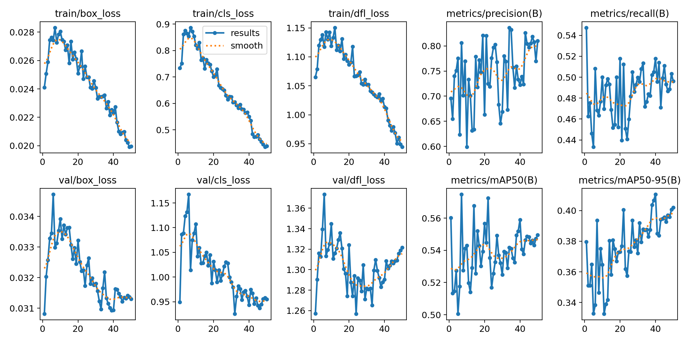

# Construction Site Safety Monitoring with YOLO11 (25 Classes)

[](https://www.python.org/)
[](https://docs.ultralytics.com/)
[](https://universe.roboflow.com/roboflow-universe-projects/construction-site-safety/dataset/30)
[](LICENSE)

Multi-class **construction site PPE (Personal Protective Equipment) & machinery safety monitoring** built with **Ultralytics YOLO11**. This repository combines systematic model benchmarking (**YOLO11s** vs. **YOLO11m** vs. **custom outdoor augmentation**) on **25 safety & machinery classes** with a modular Python package and CLI that classifies detections into compliant PPE, safety violations (`NO-Hardhat`, `NO-Safety Vest`, `NO-Mask`), personnel, and heavy equipment.



---

## Highlights

- **Industrial 25-Class Safety Taxonomy**: Detects both **PPE compliance** (`Hardhat`, `Safety Vest`, `Mask`, `Gloves`) and **PPE violations** (`NO-Hardhat`, `NO-Safety Vest`, `NO-Mask`), alongside workers, site equipment (`Safety Cone`, `Ladder`, `fire hydrant`), and 14 vehicle/machinery classes (`Excavator`, `dump truck`, `wheel loader`, `machinery`, etc.).
- **Controlled Model Benchmarking**: Compares `YOLO11s`, `YOLO11m`, and `YOLO11s + Custom Augmentation` on the same held-out 82-image test split (806 instances), showing why the compact `YOLO11s + Custom Aug` model achieves the highest test `mAP@50` (**0.600**) and `mAP@50–95` (**0.440**) at ~2.5× faster inference and half the checkpoint size of `YOLO11m`.
- **Actionable PPE Compliance CLI (`ppe_safety/`)**:
  - Supports single images, image batches (directories), and video files (`.mp4`, `.avi`, `.mov`, `.mkv`).
  - Color-codes bounding boxes by operational category, renders an optional compliance alert HUD (`PPE OK` / `PPE ALERT`), and exports structured JSON compliance reports.
- **Weight-Free Unit Test Suite**: Core `pytest` suite runs cleanly without downloading `weights/best.pt` via a mocked detector; real-model integration tests are isolated under `@pytest.mark.real_model`.

---

## Repository Structure

```text
construction-site-safety-yolo/
├── configs/
│   ├── data.example.yaml              # Reference 25-class schema & CC BY 4.0 attribution
│   └── train_augment.yaml             # Portable YOLO11 training & outdoor augmentation config
├── ppe_safety/
│   ├── config.py                      # Settings, .env loader, and 25-class safety taxonomy
│   ├── compliance.py                  # Pure PPE compliance & violation analyzer + aggregation
│   ├── detector.py                    # YOLO11 wrapper, SafetyDetector protocol, category drawing
│   └── cli.py                         # CLI for image, directory, and video inference + JSON export
├── notebooks/
│   └── construction_site_safety_experiments.ipynb  # Clean reproducible experimentation notebook
├── scripts/
│   └── download_weights.py            # Downloads weights/best.pt from GitHub Release v1.0.0
├── tests/
│   ├── test_compliance.py             # Unit tests for 25-class taxonomy & compliance analysis
│   └── test_cli.py                    # Mocked CLI/video/downloader tests + optional real_model test
├── docs/assets/                       # Verified test-set plots, comparison chart, sample output
├── weights/.gitkeep                   # Local target directory for best.pt (gitignored)
├── .env.example
├── requirements.txt                   # Core inference dependencies
└── requirements-train.txt             # Optional training, plotting, and testing dependencies
```

---

## Dataset Overview

Trained and evaluated on the public **Construction Site Safety v30** dataset from Roboflow Universe (**CC BY 4.0**, 717 raw images, 25 classes):

| Split | Images | Bounding Box Instances | Classes Present |
| :--- | :---: | :---: | :---: |
| **Train** | 521 | 4,031 | 25 / 25 |
| **Validation** | 114 | 733 | 21 / 25 |
| **Test (Held-Out)** | 82 | 806 | 19 / 25 |

**Operational Category Grouping (implemented in `ppe_safety/config.py`):**
- **PPE Compliant (4)**: `Hardhat`, `Safety Vest`, `Mask`, `Gloves`
- **PPE Violations (3)**: `NO-Hardhat`, `NO-Safety Vest`, `NO-Mask`
- **Site & Personnel (4)**: `Person`, `Safety Cone`, `Ladder`, `fire hydrant`
- **Machinery & Vehicles (14)**: `Excavator`, `wheel loader`, `dump truck`, `machinery`, `truck`, `truck and trailer`, `semi`, `trailer`, `van`, `mini-van`, `SUV`, `sedan`, `bus`, `vehicle`

---

## Experiment Results & Model Comparison

All three primary models were trained for **50 epochs** at `imgsz=640` and evaluated on the exact same held-out **Test split (82 images, 806 instances)**:

| Model Variant | Checkpoint Size | Precision | Recall | mAP@50 | mAP@50–95 | Inference Speed (local val) | Key Takeaway |
| :--- | :---: | :---: | :---: | :---: | :---: | :---: | :--- |
| **YOLO11s (Baseline)** | 19.2 MB | **0.748** | 0.521 | 0.595 | 0.437 | ~80–89 ms/img | Strong precision & lightweight footprint |
| **YOLO11m (Baseline)** | 40.5 MB | 0.745 | **0.540** | 0.586 | 0.425 | ~207–212 ms/img | Slightly higher recall (+1.9%), ~2.5× slower, more train/test gap |
| **YOLO11s + Custom Aug (`v1.0.0`)** | 19.2 MB | 0.723 | 0.522 | **0.600** | **0.440** | ~90 ms/img | **Best overall test mAP@50 and mAP@50–95**; selected for release |



### Key PPE Per-Class Test Metrics (`YOLO11s + Custom Aug`, `v1.0.0`)

| Class | Test Images | Instances | Precision | Recall | mAP@50 | mAP@50–95 |
| :--- | :---: | :---: | :---: | :---: | :---: | :---: |
| `Hardhat`\* | — | — | — | — | **0.803** | — |
| `Safety Vest` | 22 | 61 | 0.723 | 0.721 | **0.763** | 0.486 |
| `Person` | 59 | 174 | 0.865 | 0.649 | **0.755** | 0.553 |
| `Mask` | 16 | 28 | 0.911 | 0.679 | **0.743** | 0.510 |
| `NO-Safety Vest` | 36 | 90 | 0.835 | 0.506 | **0.606** | 0.359 |
| `NO-Mask` | 30 | 79 | 0.831 | 0.374 | **0.566** | 0.162 |
| `NO-Hardhat` | 25 | 41 | 0.643 | 0.512 | **0.511** | 0.301 |
| `Gloves` | 10 | 40 | 0.683 | 0.216 | **0.292** | 0.178 |

*\*`Hardhat` `mAP@50 = 0.803` is taken from the `val12` test-set Precision–Recall curve (`docs/assets/pr_curve_11s_aug.png`); the remaining per-class columns come from the archived validation summary table. Heavy machinery classes also perform strongly on test `mAP@50`: `dump truck` **0.846**, `Excavator` **0.796**, `wheel loader` **0.760**.*

> **Error Analysis & Limitations**: On a compact 717-image dataset split across 25 classes, small and frequently occluded PPE items such as `Gloves` (40 test instances) and small distant `NO-Mask` boxes remain the hardest targets (low recall). Conversely, larger and visually distinct classes (`Hardhat`, `Safety Vest`, `Person`, `Excavator`, `dump truck`) achieve 0.75–0.85 `mAP@50`. Adding targeted close-up crops or higher input resolution (`imgsz=960` / SAHI tiling) is the clearest path for further recall gains on small PPE.

### Test-Set Diagnostics (`YOLO11s + Custom Aug` — Release `v1.0.0`)

| Normalized Confusion Matrix (Test Split) | Precision–Recall Curve (Test Split, `mAP@50 = 0.600`) |
| :---: | :---: |
|  |  |

### Extended Local Fine-Tuning Check (`train_11s5`, +50 Epochs Validation Curves)

To verify whether training beyond 50 epochs improved generalization, an additional 50-epoch local fine-tuning run (`train_11s5`) was initialized from the `YOLO11s + Custom Aug` checkpoint and tracked on the 114-image validation split (best validation epoch 40: `P=0.722`, `R=0.518`, `mAP@50=0.559`, `mAP@50–95=0.411`). As shown below, `val/dfl_loss` begins drifting upward after ~epoch 30 while training losses continue falling, confirming mild overfitting—so the 50-epoch `YOLO11s + Custom Aug` checkpoint was retained as the `v1.0.0` release.



> **Reproducibility Note (Historical `v1.0.0` Checkpoint vs. Clean Configs)**: During cleanup for standalone open-source reproducibility, two bugs in the original experiment files were fixed: (1) `configs/train_augment.yaml` removes local Windows paths and enables `pretrained: true` for COCO transfer learning, and (2) the optional `model.tune(...)` cell in `notebooks/construction_site_safety_experiments.ipynb` sets `val=True` and passes `data=str(data_yaml)` so validation fitness is properly scored. Re-training from scratch with these cleaned configs may therefore yield slightly different (typically equal or stronger) metrics than the historical `v1.0.0` checkpoint.

---

## Quick Start

### 1. Clone and install dependencies

```bash
git clone https://github.com/wyde1/construction-site-safety-yolo.git
cd construction-site-safety-yolo

python -m venv .venv
# Linux / macOS:
source .venv/bin/activate
# Windows PowerShell:
# .venv\Scripts\Activate.ps1

pip install -r requirements.txt
```

*(Optional)* Install training, plotting, and testing dependencies:

```bash
pip install -r requirements-train.txt
```

### 2. Download the trained weights (`best.pt`)

Model checkpoints (`*.pt`) are excluded from Git and distributed via GitHub Releases (`v1.0.0`, `YOLO11s + Custom Aug`, 19.2 MB):

```bash
python scripts/download_weights.py
```

If the release is not published yet or you trained your own checkpoint, copy `best.pt` manually to `weights/best.pt` (or pass `--weights /path/to/best.pt` / set `MODEL_PATH` in `.env`).

### 3. Run PPE Safety Compliance Inference (CLI)

```bash
# Single image + structured JSON compliance report
python -m ppe_safety.cli --source path/to/site_photo.jpg --output-dir outputs --conf 0.35 --save-json

# Batch inference on a folder of images
python -m ppe_safety.cli --source path/to/site_images/ --output-dir outputs --save-json

# Video stream / clip inference (annotated MP4 + per-frame JSON summary)
python -m ppe_safety.cli --source path/to/site_cctv.mp4 --output-dir outputs --conf 0.35 --save-json
```

Example JSON compliance report (`*_report.json`, abbreviated — full output also includes `counts_by_class`, `counts_by_category`, and per-box `detections`):

```json
{
  "mode": "image",
  "source": "site_photo.jpg",
  "output_media": "site_photo_annotated.jpg",
  "inference_ms": 88.4,
  "compliance": {
    "total_detections": 9,
    "compliant_ppe_count": 3,
    "violation_count": 2,
    "person_count": 3,
    "machinery_count": 1,
    "has_violations": true,
    "violations_by_class": {
      "NO-Safety Vest": 2
    }
  }
}
```

---

## Reproducing Training & Experiments

1. Copy `.env.example` to `.env` and set your `ROBOFLOW_API_KEY`.
2. Install training dependencies (`pip install -r requirements-train.txt`).
3. Run `notebooks/construction_site_safety_experiments.ipynb` (all Ultralytics HUB dependencies have been removed; training runs completely locally using `configs/train_augment.yaml`).

---

## Running Tests

Default unit & CLI tests use a mocked detector and pass **without `weights/best.pt`**:

```bash
pytest -v -m "not real_model"
```

Run the full test suite including the real YOLO11s integration test (automatically skipped if `weights/best.pt` is not present):

```bash
pytest -v
```

---

## Dataset Attribution & License

- **Dataset & Sample Frame**: [Construction Site Safety v30](https://universe.roboflow.com/roboflow-universe-projects/construction-site-safety/dataset/30) on Roboflow Universe (`roboflow-universe-projects/construction-site-safety`), licensed under **[CC BY 4.0](https://creativecommons.org/licenses/by/4.0/)**. This attribution explicitly covers the sample test image annotated in `docs/assets/sample_detection.jpg` and the evaluation plots derived from the dataset.
- **Source Code**: Released under the [GNU Affero General Public License v3.0 (AGPL-3.0)](LICENSE) for full compatibility with the `ultralytics` dependency.
